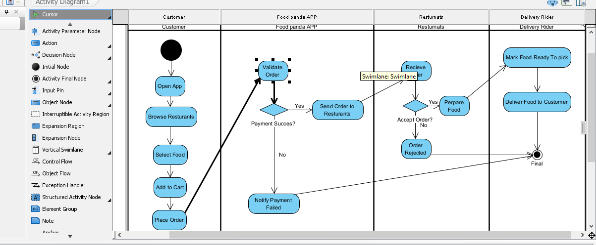
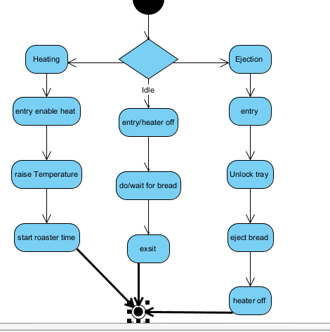

## Lab 01
# Q1: Online Ticket Reservation System

Objective: Develop a use case diagram that serves as a basis for understanding the requirements for an online ticket reservation system.

Diagram Type in Visual Paradigm: Use Case Diagram

1. System Boundary:

· Draw a large rectangle and label it: Online Ticket Reservation System

2. Actors (Place outside the system boundary):

· Customer (Primary Actor)
· Payment Gateway (Secondary Actor - e.g., Bank/Credit Card System)

3. Use Cases (Place as ovals inside the system boundary):

· Search Tickets
· Select Seats
· Make Payment
· Generate E-Ticket

4. Associations (Draw solid lines connecting Actors to Use Cases):

· Connect Customer to: Search Tickets, Select Seats, and Make Payment.
· Connect Payment Gateway to: Make Pa

---

# Q2: Credit Card Processing System

Objective: Identify actors and use cases from the provided case study and draw a use case diagram.

1. System Boundary:

· Draw a large rectangle and label it: Credit Card Processing System

2. Actors (Place outside the system boundary):

· Customer
· Vendor
· Credit Card Machine

3. Use Cases (Place as ovals inside the system boundary):

Based on the text provided in the lab manual, extract these actions:

· Select Item
· Make Bill
· Swap Card
· Process Transaction
· Issue Balance Statement
· Sign Receipt

4. Associations (Draw solid lines connecting Actors to Use Cases):

Match the text from the case study to connect the lines:

· Connect Customer to: Select Item ("Customer should select the item...")
· Connect Customer to: Swap Card ("Customer gives the credit card to the vendor to swap...")
· Connect Customer to: Sign Receipt ("Customers put the signature in the receipt...")
· Connect Vendor to: Make Bill ("Vendor makes the bill for the selected item.")
· Connect Vendor to: Issue Balance Statement ("Vendor will issue the balance statement...")
· Connect Credit Card Machine to: Process Transaction ("The required amount transaction is done by the card reader.")

---

Important Lab Instructions to Remember:

1. Do not send your assignment via Email or WhatsApp.
2. You must export your Visual Paradigm diagrams as images (PNG/JPG) and upload them to QOBE.
3. Ensure the work is entirely your own to avoid a ZERO CREDIT penalty for cheating.
!{lab 01 output}(Lab01/4.png)

## Lab 2 Assignment: Software Construction & Development

---

# Q1: Activity Diagram - foodPanda Application

Objective: Visualize the process of ordering food using Swimlanes.
Diagram Type in Visual Paradigm: Activity Diagram

Swimlane Structure:

Create 3 vertical swimlanes with the following headings:

1. Customer
2. foodPanda System
3. Restaurant/Delivery

Step-by-Step Flow (Action Nodes):

Draw these actions (rounded rectangles) in the specific swimlanes and connect them with Control Flow arrows.

1. [Start Node] (Black circle) -> Placed in Customer lane.
2. [Customer] Open App & Search Food
3. [Customer] Select Items & Add to Cart
4. [Customer] Place Order & Make Payment
5. [System] Receive Order & Send to Restaurant
6. [Restaurant] Accept Order & Prepare Food
7. [Restaurant] Handover Food to Rider
8. [System] Update Status (Out for Delivery)
9. [System] Deliver Food to Customer
10. [Customer] Receive Food
11. [End Node] (Circle with a dot inside) -> Placed in Customer lane.

---

# Q2: State Machine Diagram - Toaster

Objective: Draw a State diagram, list activities within each state, and identify triggered/triggerless events.
Diagram Type in Visual Paradigm: State Machine Diagram

1. States & Internal Activities:

· State: Idle
  · Activity: Waiting for bread.
· State: Toasting
  · Activity: Heating coils are active.
  · Internal Triggerless Event: Timer counting down.
· State: Popped Up
  · Activity: Toast is ready.
· State: Unplugged
  · Activity: No power.

2. Transitions (Triggers):

· From Idle to Toasting: Trigger = Press Lever Down
· From Toasting to Popped Up: Trigger = Timer Expires (This is a triggerless event inside the Toasting state that causes the transition).
· From Popped Up to Idle: Trigger = Remove Toast
· From any state to Unplugged: Trigger = Power Cord Pulled

How to draw it:

1. Add an Initial State (black dot) pointing to Idle.
2. Create the 4 states (rounded rectangles) listed above.
3. Draw transition arrows between them and label the arrows with the triggers (e.g., write "Press Lever" on the arrow).
4. You can add an Entry or Do activity inside the states by double-clicking the state and typing the activity (e.g., "Do: Heating").

---

# Q3: State Machine Diagram - Elevator/Lift

Objective: Draw a state machine diagram for an elevator system.
Diagram Type in Visual Paradigm: State Machine Diagram

States to include:

1. Idle (Stationary): Doors closed, waiting for a command.
2. Moving Up: Elevator is traveling upward.
3. Moving Down: Elevator is traveling downward.
4. Doors Open: Elevator has stopped at a requested floor.

Transitions (Triggers):

· Idle -> Moving Up: Trigger = Floor button pressed (Higher Floor)
· Idle -> Moving Down: Trigger = Floor button pressed (Lower Floor)
· Moving Up -> Doors Open: Trigger = Reached requested floor (Sensor)
· Moving Down -> Doors Open: Trigger = Reached requested floor (Sensor)
· Doors Open -> Idle: Trigger = Door Close Timer expires / Close Button pressed

Visual Paradigm Tips for Q3:

· Make sure to include an Initial Node (black circle) pointing to Idle.
· Add transition arrows between the states and write the triggers on the lines.
· If you want to make it look advanced, you can add a Choice node (diamond shape) between Idle and the Moving states to show that the system decides direction based on the button pressed.

[Lab02](Lab02/3.png)

---